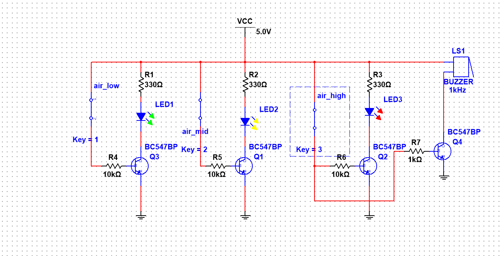

# Sistem-Sensor-Pendeteksi-Banjir-3-Level
Rangkaian sistem peringatan dini kenaikan debit air bertingkat berbasis probe konduktor tembaga dan pensaklaran komponen diskrit dengan indikator LED serta alarm buzzer.

# Sistem Sensor Pendeteksi Banjir 3-Level Berbasis Transistor Diskrit
*(Proyek Praktikum Rangkaian Elektronika - Politeknik Elektronika Negeri Surabaya)*

## 📝 Deskripsi Proyek
Proyek ini mengimplementasikan rangkaian elektronika analog diskrit untuk mendeteksi kenaikan level permukaan air secara bertahap (3 tingkatan) sebagai sistem peringatan dini banjir. Rangkaian dirancang dan disimulasikan menggunakan software NI Multisim dengan memanfaatkan karakteristik transistor sebagai sakelar elektronik (*switching*).

*Catatan: Karena proyek fisik laboratorium telah dikumpulkan, halaman ini difokuskan sebagai dokumentasi arsitektur skematik dan file simulasi interaktif.*

## 📐 Spesifikasi Parameter & Komponen Sirkuit
- **Tegangan Sumber (VCC):** 5.0 Volt DC.
- **Logika Sensor (Probe Tembaga):** Disimulasikan menggunakan sakelar interaktif (`air_low`, `air_mid`, `air_high`). Ketika air menyentuh probe tembaga, jalur sirkuit akan tertutup (logika sakelar aktif).
- **Transistor Switching:** 4x NPN Transistor **BC547BP** sebagai pengendali arus ke beban indikator.
- **Resistor Pembatas:** Resistor basis 10 kΩ untuk proteksi kaki transistor dan 330 Ω untuk pembatas arus LED.
- **File Mentah Simulasi:** Tersedia di repositori ini (`project banjir.ms14`) untuk pengujian sirkuit interaktif langsung di NI Multisim.

## 🎛️ Logika Indikator Tingkatan Air
1. **Level 1 (air_low):** Saat air menyentuh probe terendah, transistor Q3 aktif dan menyalakan **LED 1 (Hijau)**.
2. **Level 2 (air_mid):** Saat air naik ke probe tengah, transistor Q1 aktif dan menyalakan **LED 2 (Kuning)**.
3. **Level 3 (air_high):** Saat air mencapai batas tertinggi, transistor Q2 aktif menyalakan **LED 3 (Merah)** sekaligus memicu transistor Q4 untuk membunyikan **Buzzer 1 kHz** sebagai alarm tanda bahaya.

## 📷 Skema Rangkaian (NI Multisim)

